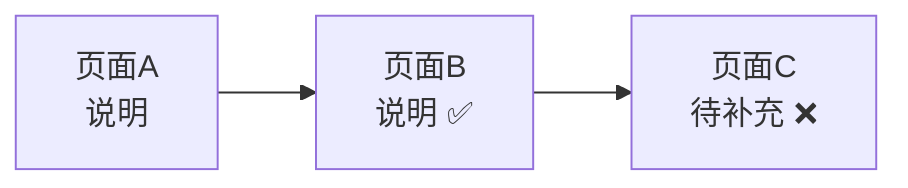
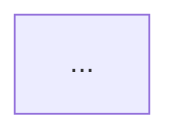
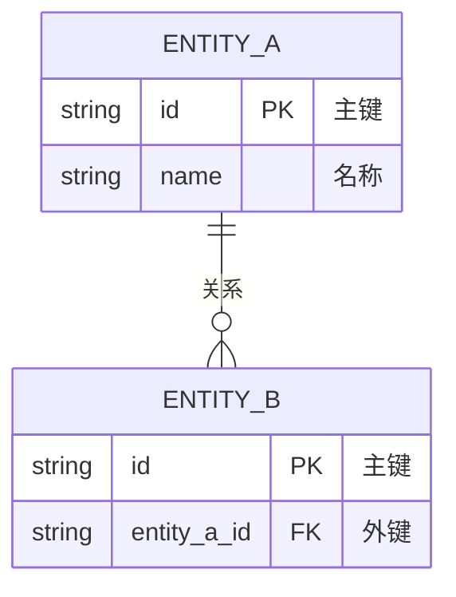
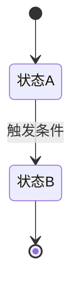

# 版本PRD骨架模板 V7.2

本模板定义一份版本PRD的**整体骨架**。单个模块的 3 段详细结构（功能用例与验收 / 核心流程 / 数据流向）见 `prd-module-section.md`。

**V7.2 重构**：评审模式骨架重组——页面清单提前（二）、AC紧邻每个模块UC（三）、异常并入流程（四.5）、状态机改为可选（六）。角色列表编号修正为 `一.1`。

**V7.1 新增**：评审模式骨架（5 步业务建模），适用于评审准备场景。

**V7.0 重构**（相对 V6.0 重量版）：
- 组织单位：页面级 6 节 → **模块级 3 段**
- 字段表：11 列 → **8 列**
- 编号：RULE-{MODULE}-{SEQ} → **UC/AC-{代号}-{序号}** + 对应用例强绑定
- 验收：弱 → **Given-When-Then**（UC↔AC 可追溯）
- 可选全局章节：4 个（角色/单据/接口时序/非功能）→ **2 个**（单据/接口时序），非功能并入核心流程
- 版本概述 5 子节 → **范围边界 + 角色列表**（极简）

---

## 一、设计原则

1. **一页纸讲清楚**，图大于文，只写差异不写常识
2. **先讲故事再列数据** — 叙述体建立认知，表格承载细节
3. **一行说清一个字段** — 字段的所有信息压在一行，不在多处重复
4. **按需生成** — 不适用章节直接省略，不留空占位、不写"不适用"

---

## 二、编号体系（核心）

全文档统一编号，确保用例、验收、规则可追溯。

| 对象 | 格式 | 示例 |
|------|------|------|
| 模块代号 | 英文首字母大写（取自模块英文名） | Product→P，Order→O，Auth→A |
| 章节号（版本级） | 中文数字 | 一、二、三 |
| 章节号（模块级） | `{版本级章节}.{代号}.{子节}` | 二.P.2、三.O.1 |
| 功能用例 | `UC-{代号}-{序号}` | UC-P-01、UC-O-03 |
| 验收标准 | `AC-{代号}-{序号}` | AC-P-01、AC-O-02 |
| 业务规则 | `RULE-{代号}-{序号}` | RULE-P-001 |

**关键约束**：
- 模块代号全局唯一，不跨模块冲突
- 一条用例 `UC` 可对应多条验收 `AC`（正常+异常），通过验收表「对应用例」列绑定
- 同一规则只编号一次，不重复罗列

---

## 三、骨架结构

```markdown
# {项目名} - PRD V{版本号}

> 版本：V{版本号} | 最后更新：{日期}
> 原则：一页纸讲清楚，图大于文，只写差异不写常识

---

## 一、范围边界

### 1.1 本次做（In Scope）

| 编号 | 模块 | 代号 | 功能点 | 优先级 | 说明 |
|------|------|:-:|--------|:-:|------|
| F-01 | 商品管理 | P | | P0 | |
| F-02 | 订单管理 | O | | P1 | |

### 1.2 本次不做（Out of Scope）

- 不做项1（原因）
- 不做项2（原因）

---

## 二.1 角色列表

| 角色 | 代号 | 说明 |
|------|:-:|------|
| 供应商 | SP | |
| 审核员 | RV | |
| 运营人员 | OP | |

---

═════════ 以下为模块级，每个模块重复 3 段 ═════════

## 二.{代号}.2 功能用例与验收
（使用 prd-module-section.md「功能用例与验收」段；验收表结尾处输出测试账号，全文仅一次）

## 三.{代号} 核心流程
（使用 prd-module-section.md「核心流程」段）

## 四.{代号} 数据流向
（使用 prd-module-section.md「数据流向」段；字段表含统计口径指标）

═════════ 以上模块级重复 ═════════

---

## {N}、单据流转  `[可选 · 有核心实体时]`

### {N}.1 {实体名}生命周期

创建 → 提交 → 审核 → 生效 → 变更 → 作废

| 阶段 | 参与字段 | 系统响应 | 前置条件 |
|------|----------|----------|----------|
| 创建 | {字段} | {逻辑} | {条件} |

---

## {N+1}、接口时序  `[可选 · 跨系统时]`

### {N+1}.1 同步接口

| # | 操作 | 请求路径 | 请求参数 | 响应结构 | 异常码 |
|---|------|----------|----------|----------|--------|
| 1 | 提交订单 | POST /api/order | {参数} | {响应} | STOCK_INSUFFICIENT |

### {N+1}.2 异步流程

| # | 触发事件 | 处理链路 | 重试策略 | 补偿机制 |
|---|----------|----------|----------|----------|
| 1 | 支付回调 | 支付网关→订单服务→DB | 重试3次 | 人工对账 |

---

## {N+2}、实时通信  `[可选 · 有 WebSocket/长连接推送时]`

适用于即时通讯、在线客服、实时协作等双向推送场景（REST 表达不了的服务端主动推送收口于此）。

### {N+2}.1 连接协议

| 项 | 说明 |
|----|------|
| 协议 | WebSocket（ws/wss） |
| 鉴权 | 连接 URL 携带 JWT token |
| 心跳 | ping/pong 保活，超时断开重连 |

### {N+2}.2 Action 协议

| Action | 方向 | 触发时机 | 说明 |
|--------|------|----------|------|
| send-message | 双向 | 发送消息 | 用户/客服发消息 |
| receive-message | S→C | 对方发消息 | 推送新消息 |
| user-transfer | S→C | 转接 | 通知目标客服 |
| waiting-users | S→C | 队列变化 | 推送等待列表 |

> Action 表是实时场景的核心载体。接口时序章节的 REST 表表达不了的服务端主动推送，全部收口于此。

---

## 检查清单（写完自查）

- [ ] 核心流程图能独立表达主流程吗（不看文字也能看懂）？
- [ ] 每条用例的 Given-When-Then 可独立测试吗？
- [ ] UC↔AC 对应用例列完整，每条验收可追溯到具体用例吗？
- [ ] 涉及的数据字段都标注了「来源」和「去向」吗？统计指标的计算口径写清了吗？
- [ ] 版本级内容只写一次，没在模块间重复吗？测试账号全文只出现一次吗？
- [ ] 各模块的 UC/AC/代号不跨模块冲突吗？
```

---

## 四、章节生成条件

| 章节 | 必选/可选 | 生成条件 |
|------|----------|----------|
| 一、范围边界 | 必选 | — |
| 二.1 角色列表 | 必选 | — |
| 二~四 模块 3 段 | 必选 | 每个本次范围内的模块 |
| 单据流转 | 可选 | 有核心业务实体（订单、审批、商品上架等） |
| 接口时序 | 可选 | 涉及跨系统交互（前端→网关→服务→DB/MQ） |
| 实时通信 | 可选 | 有 WebSocket/长连接推送（IM、客服、实时协作） |

> **非功能需求**（并发幂等/数据一致性）不再独立成章，并入模块级「三.{代号} 核心流程 → 异常与边界」子节。

---

## 五、两个特殊装载点

### 1. 测试账号 → 验收表结尾处

测试账号是全局一套（同一套账号测全部模块），物理位置放在**第一个模块**「二.{首个代号}.2 功能用例与验收」的验收标准表之后，**全文仅输出一次**。其余模块验收表后加引用：

```
> 测试账号见「二.{首个代号}.2 测试账号」
```

格式：

```markdown
#### 测试账号

| 手机号 | 姓名 | 角色 | 状态 | 用途 |
|--------|------|------|------|------|
| 138xxxx | 供应商甲 | SP | 正常 | 新增商品 |
验证码：{规则或固定值}
重置：浏览器控制台执行 `Auth.resetAccounts()` 恢复初始数据
```

### 2. 数据口径 → 字段说明表

统计类指标（销量、好评率、折扣等）作为**特殊字段行**写入「四.{代号}.2 字段说明」表，「来源」列填计算公式：

```markdown
| 字段中文名 | 字段名 | 类型 | 校验规则 | 取值范围 | 来源 | 去向 | 错误提示 | 说明 |
|-----------|--------|------|----------|----------|------|------|----------|------|
| 商品名称 | spu_name | string | 非空 | — | 供应商输入 | 列表/详情/审核页 | 请填写商品名称 | 商品主名称 |
| 销量 | sales_volume | number | — | ≥0 | SKU已完成订单件数求和 | 商品列表/详情 | — | 销量统计口径 |
| 好评率 | favor_rate | number | — | 0-100% | 五星好评数÷全部评价数×100% | 商品详情 | — | 好评率口径，保留一位小数 |
```

---

## 六、与重量版（V0.51）的差异速查

| 维度 | 重量版 V0.51 | 精简版 V7.0（本版） |
|------|-------------|-------------------|
| 组织单位 | 页面级 | 模块级 |
| 模块内结构 | 6 节/页 | 3 段/模块 |
| 字段表 | 11 列 | 8 列 |
| 验收 | 无独立验收 | Given-When-Then + UC↔AC 绑定 |
| 编号 | RULE-{MODULE}-{SEQ} | UC/AC-{代号}-{序号} |
| 可选全局章节 | 4 个 | 2 个 |
| 版本级 | 版本概述 5 子节 | 范围边界 + 角色列表 |

重量版存档于 `archive/V0.51-heavy/`，需要逐页面详尽交互时回退使用。

---

## 七、评审模式骨架 [V7.2 重构]

评审模式面向评审准备场景，采用 4 步业务建模结构。适用于用户列出评审议题、需要快速梳理现有原型覆盖情况的场景。页面清单提前到第二章，评审者第一眼看清覆盖；AC 紧跟每个模块的 UC 表，追溯不跳读；异常并入流程，与流程图强关联；状态机仅评审涉及状态变更时生成。

```markdown
# PRD-{项目名}-{模块名}-V{版本号}

> **版本**: V{版本号} | **日期**: {日期} | **状态**: 评审稿
>
> **原型目录**: `{源码目录}`
>
> **评审议题**:
> 1. {议题一}
> 2. {议题二}
> ...

---

## 一、范围边界

| 范围 | 内容 |
|------|------|
| **In Scope** | {从评审议题中提取的范围} |
| **Out Scope** | {明确排除的内容} |

---

### 一.1 角色列表

| 代号 | 角色 | 说明 |
|------|------|------|
| R-{CODE} | {角色名} | {职责描述} |

---

## 二、页面清单

| 序号 | 页面名称 | 文件名 | 路由 | 状态 | 评审点 |
|------|----------|--------|------|------|--------|
| 1 | {页面名} | {file}.html | /{route} | ✅ 已有原型 | 评审点N |
| 2 | **{页面名}** | **{file}.html** | **/{route}** | ❌ 待补充 | 评审点N |

### 二.1 已有页面详情

#### 页面N: {页面名}（{file}.html）

- **入口**: {导航路径}
- **关键元素**: {筛选区/列表/弹窗等}
- **与评审议题对应**: {说明}

### 二.2 待补充页面骨架

#### 页面M: {页面名}（{file}.html）【待补充】

> **说明**: {该页面与评审议题的关系，已知的功能要求}

**【请补充：页面布局、字段、交互细节】**

### 二.3 页面跳转关系



---

## 三、业务场景（用例图）

### 三.1 {模块一}模块

**测试账号**: {账号信息}（全文仅首个模块输出）

| UC编号 | 用例名称 | 角色 | 说明 |
|--------|----------|------|------|
| UC-{代号}-001 | {用例名} | R-{角色} | {一句话描述} |

**验收标准（AC-{代号}）**

| AC编号 | 验收标准 | 对应用例 | Given | When | Then |
|--------|----------|:--------:|-------|------|------|
| AC-{代号}-001 | {标准描述} | UC-{代号}-001 | {前置条件} | {触发动作} | {预期结果} |

### 三.2 {模块二}模块

| UC编号 | 用例名称 | 角色 | 说明 |
|--------|----------|------|------|
| ... | | | |

**验收标准（AC-{代号}）**

| AC编号 | 验收标准 | 对应用例 | Given | When | Then |
|--------|----------|:--------:|-------|------|------|
| ... | | | | | |

---

## 四、业务流程

### 四.1 {流程一}流程



### 四.2 {流程二}流程


### 四.5 异常与边界

| 场景 | 边界条件 | 处理方式 |
|------|----------|----------|
| {场景} | {条件} | {处理} |

---

## 五、实体关系

### 五.1 核心实体



### 五.2 字段说明表

#### 五.2.1 {实体一}

| 序号 | 字段名 | 显示名 | 类型 | 必填 | 唯一 | 校验规则 | 来源/口径 |
|------|--------|--------|------|------|------|----------|-----------|
| 1 | {field} | {显示名} | {type} | 是/否 | 是/否 | {规则} | {来源} |

> **标粗行为本次评审新增字段。**

---

## 六、状态机 `[可选 · 评审涉及状态变更时]`

### 六.1 {实体一}状态机



### 六.2 状态流转表

| 实体 | 当前状态 | 目标状态 | 触发动作 | 守卫条件 | 执行角色 |
|------|----------|----------|----------|----------|----------|
| {实体} | {状态A} | {状态B} | {动作} | {条件} | R-{角色} |

---

*文档结束。标注 ❌ 的页面为本次评审前需补充原型的页面。*
```

### 评审模式关键规则

1. **评审议题** — 文档顶部列出，作为 In Scope 的来源
2. **页面状态标记** — 每个页面标注 ✅已有原型 或 ❌待补充
3. **占位处理** — 缺失页面写 `【请补充：页面布局、字段、交互细节】`，不编造内容
4. **新增字段标记** — ER 图和字段表中用 **粗体** 标记本次新增字段
5. **已有原型优先** — 从已有 HTML 源码中提取字段、流程、交互，不臆测
6. **AC 紧邻 UC** — 每个模块的 UC 用例表后紧跟其 AC 验收表，不集中放置
7. **异常并入流程** — 异常与边界作为四.5，与流程图强关联，不独立成章
8. **状态机按需** — 仅评审涉及状态变更时生成，否则跳过
