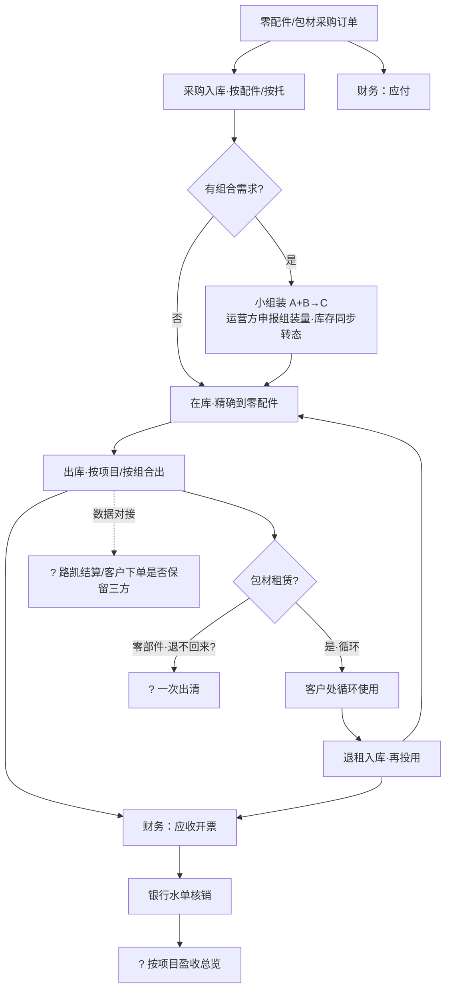

# 首绘技能回放报告（2026-09-29）

> **性质**：「首次绘制」技能 V1 的首次完整执行（dry-run），输入＝技能自带三件样板。
> **更名注记（0929）**：技能回放执行时名「首次绘制」，当日定名「**初绘原型**」（道远拍板·配套第 2 轮预留「修订原型」）；同日下午接入团队英文编码：初绘原型＝**PDM.Preparation-Prototype**（目录 `pdm-preparation-prototype`）、修订原型＝**PDM.Refinement-Prototype**。正文保留旧称，即本技能。
> **门规例外记录（道远 0929 指示）**：① check——本次按已过 check 处理（实际未过「检查文档」技能，生产使用须校验）；② S1 分桶确认——本次按已确认处理，生产使用须停下来等用户确认后才进 S2。

## 输入清单

| # | 输入 | 文件 | 状态 |
|---|---|---|---|
| ① | 逐字纪要 | references/样板-会议纪要逐字版.txt（0831 第1次对接·621 行） | 按已过 check 放行 |
| ②-a | 竞品功能对照表 | references/样板-竞品功能对照表.md（12 行） | — |
| ②-b | 问题清单 | references/样板-问题清单.md（Q01~Q09） | — |

## S1 纪要分桶

### 桶① 客户明确要的 → 进原型

| # | 需求 | 转写证据 |
|---|---|---|
| 1 | **替换吉客云＋路凯两套系统**，包装业务收归一个自研系统，且**包装先行**（仓储/运输已有系统可用） | 刘小钢 1:10「可以取代就取代掉」；17:38「最好是包装这边先做」 |
| 2 | **多项目整合＋按项目编码**：项目下绑定上下游关系，按项目看盈利/营收、出入库与全量数据 | 袁 6:06 |
| 3 | **租赁循环**：出库→退租→再投用，「有出有进不停循环」 | 袁 7:28、11:31 |
| 4 | **组合管理（子母件）**：一个型号含多配件、配件采购方不同，支持组合与单独录入 | 袁 12:05、12:27 |
| 5 | **小组装 A+B→C 全过程入系统**：组装多少、何时组装要在系统里申报管理（王琳总提议，客户方认可） | 王琳总 28:16/28:58＋刘小钢 29:24「应该是这样做的」 |
| 6 | **库存精确到零配件** | 袁 14:04 |
| 7 | **财务协同**：出入库同步财务开票＋银行水单核销 | 袁 6:06 |

### 桶② 客户明确不要的 → 不画，记对照表

| # | 项 | 转写证据 |
|---|---|---|
| 1 | 仓→工厂的运输管理（本期不涉及） | 袁 14:56 |
| 2 | 车牌号/车辆管理 | 袁 15:25「这一块不用」 |
| 3 | 运输系统那块业务（另属一客户，不在本期） | 王琳总 16:03~16:16 确认割裂 |

### 桶③ 待定/有分歧 → 不画，进问题清单

| # | 项 | 转写证据 |
|---|---|---|
| 1 | **两条业务主线纠缠**：零部件组合出给客户「退不回来」与包材租赁循环在会上混在一起谈，未明确分开管理 | 袁 12:43 vs 11:31（历史事实：0902 第2次会才纠偏为两条主线） |
| 2 | 小组装落地深度：不同项目适配性不一 | 袁 31:47「有些也不一定适应」 |
| 3 | 组合库存占用与拆解：需求月度变化，组合后可能占库存 | 袁 30:34 |
| 4 | 路凯对接：客户也在路凯系统下单改计划（三方协作）；资产属路凯，其接受度存疑 | 袁 21:26、22:48 |
| 5 | 芜湖项目库内操作范围（未开·无数据） | 姚宇涛 4:34 |

### 桶④ 业务对象与流程线索 → 进流程图

- 角色：我方（运营方）／客户／路凯（围板箱供方·其系统）／仓库运营方（代组装）／零配件供应商（多家）
- 现状件：吉客云（自购 SaaS：库存+出入库+开单+组合配比）、路凯系统（供方：出库+退租）
- 主线：零配件多家采购入库（按配件/托）→ 小组装 A+B→C（一箱一件·运营方执行）→ 出库给客户 →（包材）租赁循环退租 → 财务开票 → 银行水单核销；客户计划**每天**下达（袁 31:29）

## S4 主业务流程图（1 张·mermaid）

「？」＝分支未定，均已在问题清单立条（Q10/Q11/Q13/Q16）。

## S2/S5 输出清单

- **输出① 原型**：`原型-首绘演示.html`（6 模块·桶①全量·桶③零进入）
- **输出② 流程图**：上图（＝方案）
- **输出③ 问题清单更新**：`问题清单-更新版.md`（Q01~Q09 状态刷新＋新增 Q10~Q17）
- **输出④ 对照表更新**：`对照表-更新版.md`（12 行加「客户态度」列＋补 5 新行）

## 完工自检

- [x] 输入三件齐，check 状态已校验（按用户放行并注明）
- [x] 输出四件齐
- [x] 对照表每行有「客户态度」标注（17 行）
- [x] 问题清单无已答清重复条目（答清项已入对照表/分桶），全部标「下一轮问客户」
- [x] 原型浏览器直接打开可演示（file://·单文件）

## 互验（vs 历史人工产出 F01~F04·0831 当天）

| 维度 | 历史人工（F01~F04） | 本次技能回放 | 判定 |
|---|---|---|---|
| 功能模块 | F01：项目管理/基础资料/采购/仓储/租赁/订单协同/财务（7 组） | 6 模块（无订单协同——0831 纪要未提及，系 0902 会后补） | 回放忠于纪要；少的一组正是问题清单该问的 |
| 主循环流程 | F02 包装租赁主循环（组合→租→退→循环） | 同构，多标 4 个「？」分支 | 一致 |
| 财务闭环 | F03 开票/核销/对账 | 流程图财务支线含开票/水单核销 | 一致 |
| 路凯协同 | F04 客户下单与路凯协同图 | 画为「？」虚线分支＋Q13/Q16 | 技能按「待定不画」处理，优于历史当时直接画死 |

**关键发现（技能价值的直接证据）**：0831 纪要里两条业务主线（零部件买卖 vs 包材租赁循环）是**纠缠**着谈的——历史上 F01 因此把两条线画混，直到 0902 第2次会才纠偏（P1-R01 §1.1「重大纠偏」）。本次回放把「纠缠点」按规则压进桶③→问题清单 Q10「两条主线是否分开管理」，**下次会第一问就能纠偏**。逐字纪要＋分桶规则正好兜住这类理解陷阱。
