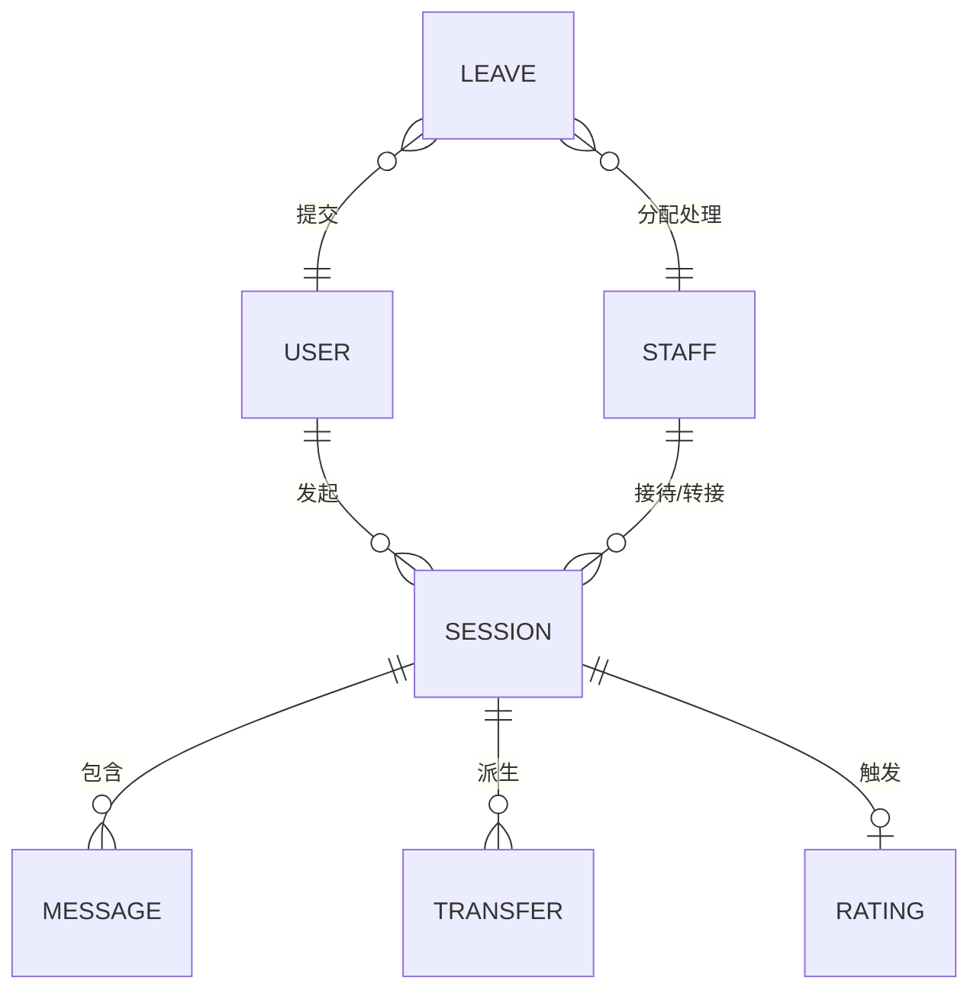
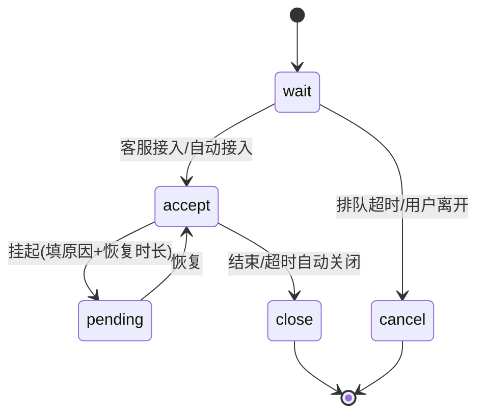

# 产出模板 — 原型业务实体建模

完整文档结构(单视角)。所有图用 Mermaid。按需裁剪——没有多租户就跳过第 1 节,没有两套状态词就跳过第 5 节。

> **双视角模式**(同时给开发+业务时用):把下列 8 节重组为四大块,**业务优先** ——
> **业务背景**(=第1节)→ **实体总览**(=第2~6节:业务域地图/关系图/状态机/状态词/枚举,作两版共用真相源)→ **业务视角**(流程/规则/角色/单据/业务缺口 ≈ 第7~8节)→ **开发视角**(类型/聚合/action/数据源/枚举常量/技术缺口)。
> 状态机**只画一次**放实体总览;业务缺口 **B ↔ 技术缺口 T** 对应映射。

---

## 1. 业务背景(若有多租户 / 归属体系)

归属树 + 出处页面 + 是否疑似演示用。

```
企业客户(租户)
└── 品牌商城
    └── 应用端/渠道(小程序/H5/PC)
        └── 用户/会话/留言/评价…
```

> 注:若归属文本是脚本轮转注入的演示数据,在此标注"疑似演示用,真实隔离维度以后端为准"。

## 2. 业务域地图(页面 → 实体 + 期次)

| 页面 | 核心实体 | 期次 | 实质/占位 |
|------|---------|------|----------|
| admin-workbench | 会话/消息 | 1期 | 实质 |
| admin-ticket | 工单 | 2期 | 占位 |

## 3. 实体关系图(Mermaid erDiagram)



## 4. 核心实体(逐个)

每个实体三块:**字段(出处)** / **状态机(Mermaid)** / **操作**。



## 5. 状态词汇映射表(存在两套词汇时必产)

| 业务状态 | 运行态词(workbench) | 历史列表词(session-list) |
|---------|--------------------|------------------------|
| 进行中 | accept | ongoing |
| 已关闭 | close | closed |
| 已转接 | (事件,非状态) | transferred |
| 已取消 | cancel | cancelled |

> 这是约定 2 的产物。没有第二套词就删掉本节。

## 6. 枚举字典(所有 badge → 业务含义)

按实体分组:会话状态 / 消息类型 / 消息来源 / 转接状态 / 评价 / 知识库 / 留言 / 紧急度 / 在线状态 / 订单…

| badge class | 取值 | 业务含义 | 出处 |
|------------|------|---------|------|
| msg type | order | 订单卡 | workbench |
| t-tag | pending | 转接待处理 | transfer |

## 7. 操作 / CRUD 矩阵

| 实体 | 操作 |
|------|------|
| 会话 | 接入/挂起/恢复/转接/结束/撤回消息/导出 |
| 话术 | 新建/编辑/复制/启停/删除 |

## 8. 业务逻辑缺口清单(强制 — PM 决策点)

**这是全文最有价值的一节。** 列出所有"原型未明示、需 PM 拍板"的业务逻辑分歧。每条:涉及实体 + 具体问题 + 建议方向。

| # | 缺口/分歧 | 涉及实体 | 需 PM 拍板 |
|---|----------|---------|-----------|
| 1 | 超时阈值两套数字不一致(todo 5/4/15 分 vs settings 15/30 分) | 会话/待办/设置 | 统一为一套,还是按场景分? |
| 2 | 欢迎语/离线语 与 话术职责重叠 | 话术/设置 | 合并到话术库,还是 settings 做默认、话术做细化? |
| 3 | cancel vs close 触发条件未明示 | 会话 | 用户主动取消 vs 系统超时关闭? |
| 4 | 客服"忙碌"状态 UI 缺失 | 客服 | 忙碌态入口与触发条件? |

> 来源:从"交叉验证状态机时发现的矛盾""职责重叠""UI 缺失/推断"中收集。宁多勿漏。
